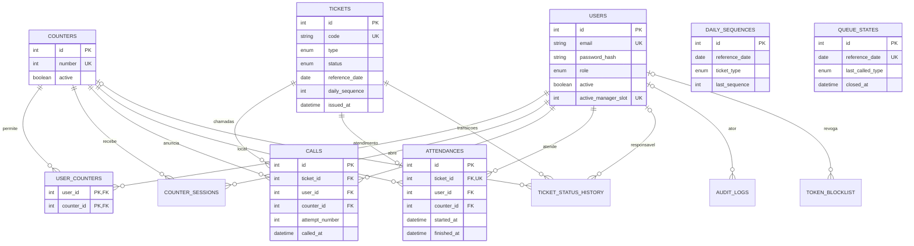

# Modelo Entidade-Relacionamento

Modelo lógico derivado dos [modelos SQLAlchemy](../../backend/app/models) e das
[migrations](../../backend/migrations/versions). Tipos, índices e política de UTC em
[`database.md`](../database.md). Renderização Mermaid disponível no GitHub.

`daily_sequences` e `queue_states` são controles por dia/categoria, sem chave estrangeira para
uma senha individual. `calls` tem unicidade por senha/tentativa; `tickets`, por dia/tipo/sequência.
As relações opcionais de auditoria preservam histórico quando a referência ao usuário é removida.
