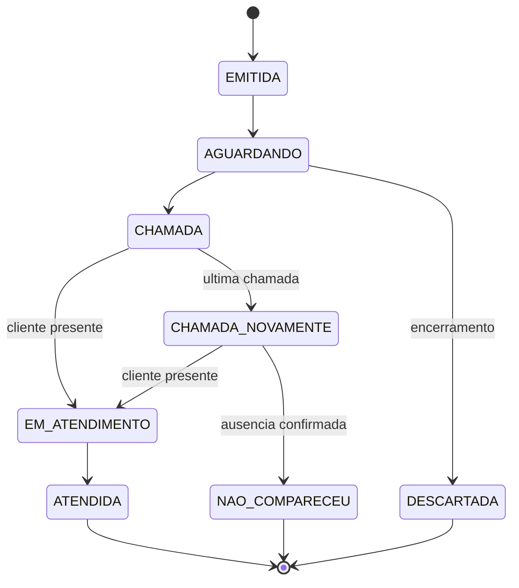
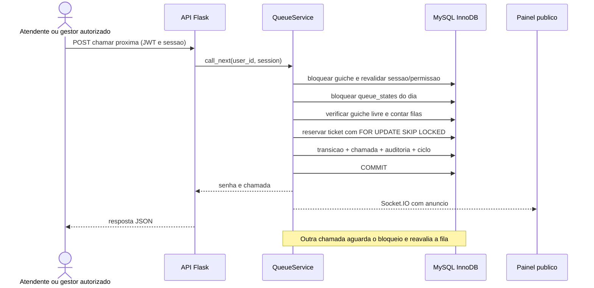
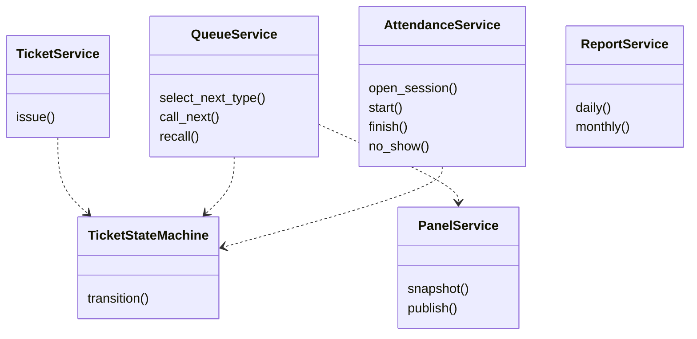

# Diagramas UML

Veja também os [casos de uso](casos-de-uso.md), com atores, pré-condições, fluxo e alternativas.

## Estados da senha

Fonte: [`TicketStateMachine`](../../../backend/app/services/state_machine.py).
O cliente presente pode iniciar atendimento após a primeira chamada; a segunda não é obrigatória.

## Sequência de chamada concorrente

## Responsabilidades

As operações públicas são anônimas para cliente/painel; as demais exigem autenticação.
O gestor acumula atendimento em guichês autorizados e administração; atendentes comuns não
possuem cadastros ou relatórios administrativos. Consulte a matriz de permissões em
[`requirements`](../../requirements/README.md).
