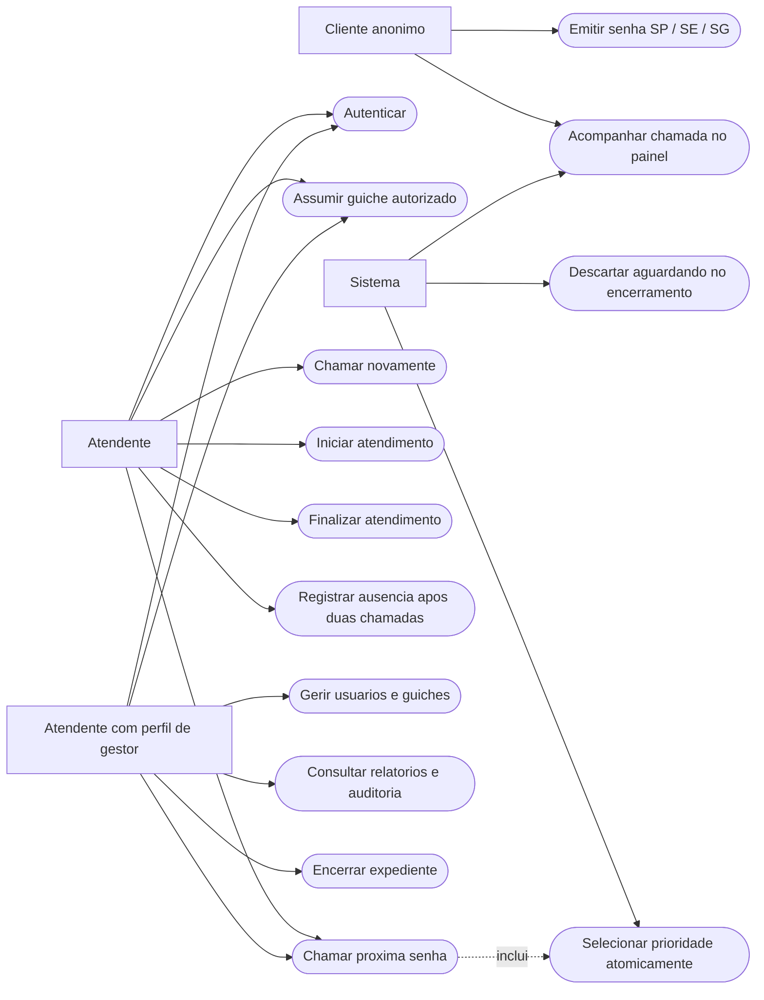

# Casos de uso

Fonte: especificacao principal pp. 3–8 e edital pp. 2–4.

| Caso | Pre-condicao | Fluxo principal | Alternativa / resultado |
|---|---|---|---|
| UC01 Emitir | Expediente 07h–17h, categoria valida | Cliente escolhe categoria; sistema reserva sequencia diaria e confirma codigo | Fora do horario/indisponibilidade: erro, sem confirmacao falsa |
| UC02 Chamar | Usuario ativo, guiche autorizado com sessao aberta e sem senha ativa | Bloquear guiche/fila, revalidar permissao, selecionar categoria, reservar senha e anunciar | Fila vazia, sessao revogada ou guiche ocupado: rejeitar sem reservar |
| UC03 Atender | Senha chamada vinculada ao guiche | Iniciar atendimento quando cliente chega; finalizar ao concluir; registrar duracao | Transicao invalida rejeitada; servico iniciado pode terminar apos17h |
| UC04 Ausencia | Primeira chamada sem comparecimento | Segunda e ultima chamada; se cliente nao comparecer, registrar NAO_COMPARECEU | Antes de duas chamadas nao pode registrar ausencia; nunca forcar percentual no atendimento real |
| UC05 Gerir | Unico gestor ativo autenticado | Cadastrar atendentes, autorizar guiches e consultar relatorios | Atendente comum recebe403; segundo gestor ativo recebe409 |
| UC06 Encerrar | 17h automatico ou comando administrativo | Descartar senhas aguardando e manter historico | Senhas ja em atendimento devem ser concluidas pelo atendente |

O gestor tambem executa UC02–UC04. AS representa a aplicacao, nao uma pessoa autenticada.
Requisitos e estados detalhados em [requisitos](../../requirements/README.md) e [UML](README.md).
